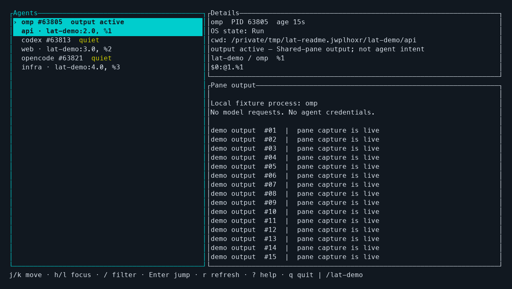

<div align="center">

# lat

**Your agents. One view. The exact pane.**

A lazygit-style terminal dashboard for **omp**, **Codex**, and **OpenCode**.<br>
Find what's running, inspect its output, and jump straight to its tmux pane.

[Quick start](#quick-start) · [tmux shortcut](#one-shortcut-from-any-pane) · [Keybindings](#keybindings) · [How status works](#honest-status-not-guesswork)

</div>



<sub>Actual `lat` terminal capture, rendered with local fixture processes. Demo output—not model responses. No agent credentials or model requests were used.</sub>

## Stop hunting through tmux windows

Running agents across projects is easy. Remembering which pane owns which one is not.

`lat` gives you one place to look:

- **Find your agents automatically.** Start them as usual; no hooks, wrappers, or agent configuration changes.
- **See the project and location.** Product, PID, activity, working directory, and tmux location stay together.
- **Read before you jump.** Preview the selected pane's last 200 grid rows without switching away.
- **Go to the exact pane.** Press **Enter**. `lat` revalidates the process and pane before navigating.
- **Keep your hands on the keyboard.** Vim-style movement, focus switching, scrolling, and filtering.
- **Keep independent agents independent.** Two agents in one directory—or even one pane—remain separate rows.

No model calls. No transcript scraping. No daemon to install.

## Quick start

You need **Rust 1.88+** to build and a terminal to run the UI. **tmux 3.8** is the runtime-verified version; without tmux, process discovery still works, but previews and jumps are unavailable.

Install directly from this repository:

```sh
cargo install --git https://github.com/masterj122517/lat.git --locked --root "$HOME/.local"
~/.local/bin/lat
```

If `~/.local/bin` is on your `PATH`, just run `lat`.

Already have supported agents running? They appear automatically. Select one with `j/k`, inspect its output, and press **Enter** to jump.

<details>
<summary>Build from a local checkout instead</summary>

```sh
git clone https://github.com/masterj122517/lat.git
cd lat
cargo build --release --locked
./target/release/lat
```

To install that checkout into `~/.local/bin`:

```sh
cargo install --path . --locked --root "$HOME/.local"
```

</details>

`lat --help` and `lat --version` work without a terminal. The interactive UI takes no arguments.

**Platform note:** runtime-verified on macOS arm64. The implementation targets Unix/macOS/Linux, but Linux has not been runtime-verified; its relevant process and protocol boundaries have deterministic fixture coverage.

## One shortcut from any pane

Put this in your tmux config to open `lat` with **prefix + t**:

```tmux
bind-key -N "Track local agents" t run-shell -b 'tmux display-popup -E -c #{q:client_name} -w 95% -h 90% -d #{q:pane_current_path} -e TMUX_PANE=#{pane_id} -T "Local agents" "$HOME/.local/bin/lat"'
```

Reload the file you edited—for example:

```sh
tmux source-file ~/.config/tmux/tmux.conf
```

Use `~/.tmux.conf` instead if that's your configuration file. Your prefix stays unchanged; `t` replaces tmux's default clock binding.

Now: **prefix + t → select an agent → Enter**. The popup closes after a successful jump. `q` closes it without navigating.

> **Why the `run-shell` and `TMUX_PANE`?** Popup jobs do not set `TMUX_PANE` automatically, and `display-popup -e` does not expand tmux formats. `run-shell` expands the invoking client and pane first, so `lat` can validate the correct client. Keep these parts of the binding.

## A familiar three-pane workflow

**Agents** on the left. **Details** at the upper right. **Pane output** below.

The list shows product, root PID, activity, project basename, and tmux location. Details add process age, OS state, full working directory, session/window names, and exact pane IDs.

The layout stacks vertically below 100 columns. Minimum terminal size: **60 columns × 16 rows**. Colors use the terminal's default background; status also has text labels.

### Keybindings

| Key | Action |
|---|---|
| `j` / `k`, ↓ / ↑ | Move through agents; scroll when preview is focused |
| `g` / `G` | First / last agent; top / bottom of preview |
| Ctrl-D / Ctrl-U | Half-page down / up |
| `h` / `l`, Tab / Shift-Tab | Cycle list, details, and preview focus |
| `/` | Filter by product, working directory, or session name |
| Enter while filtering | Accept the filter |
| Escape while filtering | Restore the previous filter |
| **Enter** outside filtering | Jump to the selected agent, regardless of focus |
| `r` | Scan immediately and refresh the selected preview |
| `?` | Show help |
| Escape | Close help or the client chooser |
| `q` / Ctrl-C | Quit; `q` is text while filtering, Ctrl-C always quits |

Filtering is case-insensitive. Selection follows process identity through refreshes. A new selection starts at the bottom of its preview; new output follows the bottom only if you're already there.

## Honest status, not guesswork

`lat` knows a process is alive. With tmux, it can also observe when its pane last produced output. It does **not** know what the agent is thinking.

| Status | What it means |
|---|---|
| **output active** | The mapped pane produced output within the last three seconds. |
| **quiet** | The pane's last output is older, or tmux has recorded no output. |
| **running** | The process is alive, but pane-output activity is unavailable. |

Activity belongs to the **shared pane**, including terminal control traffic. If several agents share a pane, they share that activity signal. Quiet is not “waiting for approval”; active is not “making progress.” Neither proves completion, success, or failure.

OS run/sleep/stopped state is shown separately. Stopped agents remain visible; dead processes disappear on the next completed scan. `lat` is a live view, not a completed-task history.

## What gets tracked?

Local CLI processes for **omp**, **Codex**, and **OpenCode**, using exact native entrypoints and the supported installed Bun/Node launcher forms.

- Internal omp workers are excluded, so a launcher plus its broker does not become duplicate agents.
- A matched Codex launcher and its direct native child are coalesced when their application arguments agree.
- Codex `exec` remains a task row; protocol/infrastructure hosts such as `exec-server` and `app-server` are excluded.
- OpenCode `serve` and `acp` hosts are excluded.
- Similar names such as `codex-helper`, product words in prompts, and arbitrary JavaScript scripts do not count.
- Supported agents outside tmux remain visible as **outside tmux**, without a fabricated jump target.

This is not a remote-machine tracker or an arbitrary process-name search. It does not infer agents from desktop renderer processes or enumerate every tmux socket.

<details>
<summary><strong>Navigation safety and tmux behavior</strong></summary>

Enter requests a fresh scan. Navigation proceeds only if the original product/PID/start-time identity and mapped pane root/target still match. A gone process or pane produces an error instead of jumping somewhere else.

- **Inside tmux:** switch an attached client viewing the invoking pane and session. Multiple matches open a client chooser; `lat` does not guess which client you meant.
- **Outside tmux:** attach to the selected pane without detaching other clients.
- **Zoom:** preserved when switching to a destination pane.
- **Server selection:** use the current launch environment's tmux server, or the default server outside tmux. Custom sockets must be selected through the launch environment.
- **Unavailable tmux:** keep process rows, clear jump targets, and show the diagnostic. Discovery never creates a server.

**tmux shares active window/pane state within sessions and windows.** Targeting one client does not give clients independent selections when they share that state.

No arbitrary input is forwarded to agent panes. Preview text is decoded, bounded to 200 lines / 256 KiB, and sanitized rather than executed as terminal controls. Trailing empty grid rows are hidden so recent text remains visible.

</details>

<details>
<summary><strong>Small by design: collection and measured overhead</strong></summary>

One collector thread reuses sysinfo process state. Scans run once per second or on request, never overlap, and publish to a replaceable latest-value slot rather than an unbounded queue. Input and rendering stay on the main thread.

Each periodic scan performs one tmux inventory call, regardless of agent count. Only the selected pane is captured, when its output timestamp or dimensions change, on first selection, or on explicit refresh. On tmux versions without output timestamps, that preview refreshes once per scan and activity remains unavailable.

Rendering occurs on input, resize, or changed visible data—not a continuous idle redraw loop.

Measured on macOS arm64 using a release build, over **30 seconds per case**:

| Owned fixture agents | Median process + inventory scan | Maximum scan | Final RSS |
|---:|---:|---:|---:|
| 0 | 26.6 ms | 28.2 ms | 9.5 MiB |
| 3 | 27.0 ms | 28.6 ms | 9.6 MiB |
| 20 | 27.3 ms | 30.4 ms | 9.8 MiB |

Two pre-existing agents remained detected in every case. These are reference measurements, not a cross-platform performance guarantee. Sixty selection/refresh cycles held RSS steady at 9,872 KiB after initial cache growth. Temporary instrumentation and fixture processes were removed afterward.

</details>

## Contributing

Bug reports, better discovery coverage, and platform verification are welcome. For a discovery or navigation bug, include the agent/version, OS, tmux version, invocation form, and what `lat` displayed. **Redact prompts, paths, credentials, and captured output before sharing.**

From a checkout:

```sh
cargo fmt --check
cargo test --locked
cargo build --release --locked
```

Process classification, tmux framing/escaping, ancestry mapping, activity boundaries, stale-target refusal, and selection behavior have deterministic regression coverage. Real-PTY smoke checks also exercised installed omp discovery, popup navigation, cross-session and split-pane jumps, zoom preservation, client choice, disappearance, and terminal restoration.

Keep the tool boring to operate: precise discovery, truthful labels, safe navigation, and no extra setup for agents.

## License

[MIT](LICENSE).

---

Built with [Rust](https://www.rust-lang.org/) and [Ratatui](https://ratatui.rs/). Inspired by the focused, keyboard-first workflow of lazygit.
